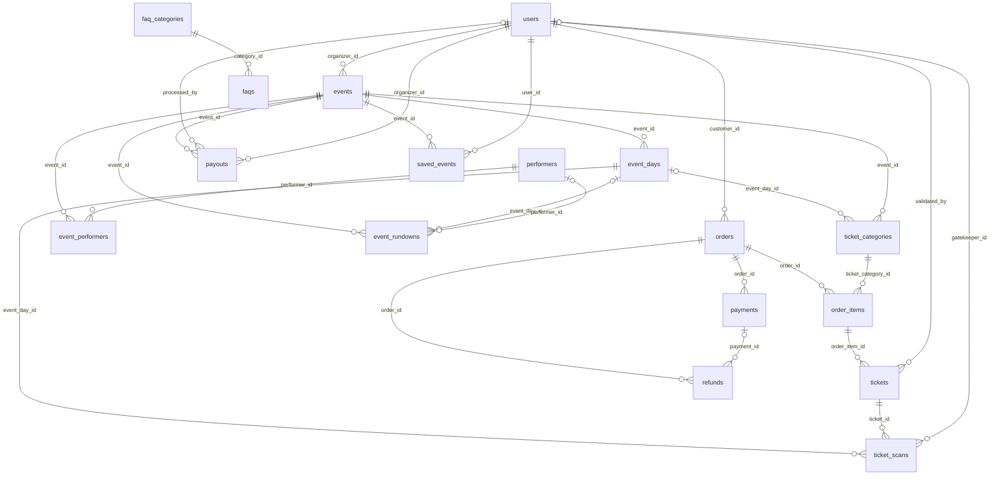

# SoundTix PDM (Physical Data Model)

Dokumen ini adalah lanjutan fisik dari [CDM](./CDM.md). CDM menjawab "entitas apa saja dan saling berhubungan bagaimana"; PDM menjawab "kolom apa, tipe apa, boleh kosong atau tidak, default-nya apa, dan apa yang benar-benar dijaga oleh database".

Semua angka dan tipe di bawah ini dibaca langsung dari `information_schema` database `soundtix` yang berjalan (MariaDB 10.4.32) pada 30 Oktober 2026 — bukan hasil hitung manual:

| Cakupan | Jumlah |
|---|---|
| Tabel domain | **19** |
| Kolom | **191** |
| Foreign key | **26** |
| Index (termasuk primary key) | **54** |

Sembilan tabel framework Laravel sengaja tidak dihitung dan didaftar di bagian 11.

## 1. Cara membaca tabel kolom

| Kolom | Arti |
|---|---|
| `Tipe` | Tipe kolom persis seperti yang dilaporkan database. Lebar tampilan integer dihilangkan agar tidak menyesatkan; `tinyint(1)` dipertahankan karena itu representasi boolean. |
| `Null` | `ya` berarti kolom boleh kosong. |
| `Default` | Nilai yang dipakai kalau INSERT tidak menyebut kolom ini. `—` berarti tidak ada default. |
| `Key` | `PK` primary key, `FK` foreign key, `UQ` unique, `IDX` index biasa. Satu kolom bisa punya lebih dari satu peran. |
| `Keterangan` | Arti bisnisnya. Kosong berarti namanya sudah cukup jelas. |

Semua nominal uang memakai `decimal(12,2)`. Tidak ada `float` atau `double` untuk uang di seluruh skema.

## 2. ERD (relasi saja)

Tabel `banners` dan `notifications` berdiri sendiri: keduanya tidak punya foreign key. `notifications` memakai relasi polimorfik (`notifiable_type` + `notifiable_id`) yang tidak bisa digambarkan sebagai foreign key.

## 3. Ringkasan tabel

| No | Tabel | Kelompok | Kolom | FK keluar | Dirujuk oleh | Fungsi |
|---|---|---|---|---|---|---|
| 1 | `users` | Akun | 15 | 0 | 7 | Akun semua peran. Satu tabel untuk admin, organizer, customer, dan gatekeeper; peran dibedakan kolom `role`. |
| 2 | `events` | Event | 21 | 1 | 6 | Event yang dijual. Dimiliki satu organizer dan harus disetujui admin sebelum tayang. |
| 3 | `event_days` | Event | 8 | 1 | 2 | Rincian hari untuk event multi-day. Event single day tidak memakai tabel ini. |
| 4 | `event_rundowns` | Event | 10 | 3 | 0 | Susunan acara per event, termasuk band dan hari tampil. |
| 5 | `performers` | Event | 6 | 0 | 1 | Master pengisi acara, dipakai bersama oleh banyak event. |
| 6 | `event_performers` | Event | 2 | 2 | 0 | Tabel pivot banyak-ke-banyak antara event dan performer. |
| 7 | `ticket_categories` | Event | 12 | 2 | 1 | Jenis tiket per event, termasuk kuota awal dan sisa stok. |
| 8 | `orders` | Penjualan | 11 | 1 | 3 | Kepala pesanan customer; menyimpan status dan batas holding lock. |
| 9 | `order_items` | Penjualan | 8 | 2 | 1 | Rincian tiket yang dipesan per kategori. |
| 10 | `payments` | Penjualan | 10 | 1 | 1 | Transaksi pembayaran ke gateway. Satu order bisa punya lebih dari satu percobaan bayar. |
| 11 | `tickets` | Penjualan | 9 | 2 | 1 | Satu baris per tiket; sumber data QR yang dipindai gatekeeper. |
| 12 | `ticket_scans` | Penjualan | 7 | 3 | 0 | Log validasi gatekeeper; satu tiket hanya boleh discan sekali per hari. |
| 13 | `refunds` | Uang keluar | 19 | 2 | 0 | Pengajuan pengembalian dana per order, termasuk data rekening tujuan. |
| 14 | `payouts` | Uang keluar | 17 | 3 | 0 | Pencairan dana event ke organizer setelah event selesai. |
| 15 | `saved_events` | Keterlibatan | 5 | 2 | 0 | Event yang disimpan customer untuk dilihat lagi. |
| 16 | `notifications` | Keterlibatan | 8 | 0 | 0 | Notifikasi in-app lewat channel database Laravel. |
| 17 | `banners` | Konten | 8 | 0 | 0 | Banner di halaman utama. |
| 18 | `faq_categories` | Konten | 7 | 0 | 1 | Kategori FAQ. |
| 19 | `faqs` | Konten | 8 | 1 | 0 | Butir pertanyaan dan jawaban. |

## 4. Detail tabel

### 4.1 `users`

Akun semua peran. Satu tabel untuk admin, organizer, customer, dan gatekeeper; peran dibedakan kolom `role`.

| Kolom | Tipe | Null | Default | Key | Keterangan |
|---|---|---|---|---|---|
| `id` | bigint unsigned | tidak | — | PK |  |
| `name` | varchar(255) | tidak | — |  | Nama tampilan. |
| `email` | varchar(255) | tidak | — | UQ | Login utama. Unik, dan karena soft delete, email user yang dihapus tetap menempati slot ini. |
| `email_verified_at` | timestamp | ya | NULL |  | Kolom bawaan Laravel. Gerbang verifikasi yang dipakai aplikasi adalah `is_verified`. |
| `is_verified` | tinyint(1) | tidak | 0 |  | Baru menjadi true setelah OTP email diverifikasi. |
| `password` | varchar(255) | tidak | — |  | Hash bcrypt, bukan teks asli. |
| `phone` | varchar(255) | ya | NULL |  | Nomor telepon/WhatsApp, opsional. |
| `role` | enum('admin','organizer','customer','gatekeeper') | tidak | 'customer' |  | Menentukan dashboard dan route yang bisa diakses. |
| `is_active` | tinyint(1) | tidak | 1 |  | Admin bisa menonaktifkan akun tanpa menghapus datanya. |
| `remember_token` | varchar(100) | ya | NULL |  |  |
| `created_at` | timestamp | ya | NULL |  |  |
| `updated_at` | timestamp | ya | NULL |  |  |
| `otp_hash` | varchar(255) | ya | NULL |  | Hash OTP, bukan kode mentahnya. |
| `otp_expires_at` | timestamp | ya | NULL |  | Batas waktu OTP; lewat dari ini OTP dianggap gugur. |
| `deleted_at` | timestamp | ya | NULL |  | Soft delete. Satu-satunya tabel domain yang memakainya. |

- **Primary key:** `(id)`
- **Unique:** `(email)`

### 4.2 `events`

Event yang dijual. Dimiliki satu organizer dan harus disetujui admin sebelum tayang.

| Kolom | Tipe | Null | Default | Key | Keterangan |
|---|---|---|---|---|---|
| `id` | bigint unsigned | tidak | — | PK |  |
| `organizer_id` | bigint unsigned | tidak | — | FK → `users.id` | Pemilik event. |
| `title` | varchar(255) | tidak | — |  |  |
| `slug` | varchar(255) | tidak | — | UQ | Dipakai URL publik `/events/{slug}`. |
| `description` | text | tidak | — |  |  |
| `banner_path` | varchar(255) | ya | NULL |  | Path file di storage, bukan URL penuh. |
| `venue_name` | varchar(255) | tidak | — |  |  |
| `city` | varchar(255) | tidak | — |  |  |
| `address` | varchar(255) | tidak | — |  |  |
| `event_date` | date | tidak | — |  | Hari pertama acara. Untuk multi-day, tanggal hari lain ada di `event_days`. |
| `duration_type` | enum('single','multi_day') | tidak | 'single' |  | `single` atau `multi_day`; menentukan apakah `event_days` dipakai. |
| `total_days` | tinyint unsigned | ya | NULL |  | Jumlah hari untuk multi-day. NULL untuk event single day. |
| `start_time` | time | tidak | — |  | Jam mulai acara. |
| `end_time` | time | ya | NULL |  | Jam selesai; boleh kosong untuk acara yang tidak punya jam selesai pasti. |
| `open_gate` | datetime | ya | NULL |  | Gate utama untuk event single day. Event multi-day memakai gate per hari. |
| `close_gate` | datetime | ya | NULL |  | Batas akhir masuk gate. |
| `status` | enum('draft','pending','published','rejected','pending_cancellation','cancelled','completed') | tidak | 'draft' |  | Alur: draft -> pending -> published/rejected; published -> pending_cancellation -> cancelled; published -> completed. |
| `rejection_reason` | text | ya | NULL |  | Diisi admin saat menolak pengajuan event. |
| `cancellation_reason` | text | ya | NULL |  | Diisi saat event dibatalkan dan menjadi alasan refund massal. |
| `created_at` | timestamp | ya | NULL |  |  |
| `updated_at` | timestamp | ya | NULL |  |  |

- **Primary key:** `(id)`
- **Unique:** `(slug)`
- **FK:** `organizer_id` → `users.id` — ON DELETE CASCADE, ON UPDATE RESTRICT
- **Index:** `(organizer_id)`

### 4.3 `event_days`

Rincian hari untuk event multi-day. Event single day tidak memakai tabel ini.

| Kolom | Tipe | Null | Default | Key | Keterangan |
|---|---|---|---|---|---|
| `id` | bigint unsigned | tidak | — | PK |  |
| `event_id` | bigint unsigned | tidak | — | FK → `events.id` |  |
| `day_number` | tinyint unsigned | tidak | — |  | Urutan hari, mulai 1. Unik per event. |
| `date` | date | tidak | — |  | Tanggal kalender untuk hari tersebut. |
| `open_gate` | datetime | ya | NULL |  | Gate untuk hari ini; menimpa gate event. |
| `close_gate` | datetime | ya | NULL |  | Batas akhir masuk gate untuk hari ini. |
| `created_at` | timestamp | ya | NULL |  |  |
| `updated_at` | timestamp | ya | NULL |  |  |

- **Primary key:** `(id)`
- **Unique:** `(event_id, day_number)`
- **FK:** `event_id` → `events.id` — ON DELETE CASCADE, ON UPDATE RESTRICT

### 4.4 `event_rundowns`

Susunan acara per event. Satu baris bisa menunjuk ke satu performer (band) dan/atau satu hari pada event multi-day; sesi non-band cukup memakai `title`.

| Kolom | Tipe | Null | Default | Key | Keterangan |
|---|---|---|---|---|---|
| `id` | bigint unsigned | tidak | — | PK |  |
| `event_id` | bigint unsigned | tidak | — | FK → `events.id` |  |
| `performer_id` | bigint unsigned | ya | NULL | FK → `performers.id` | Band yang tampil pada sesi ini. NULL untuk sesi non-band. |
| `event_day_id` | bigint unsigned | ya | NULL | FK → `event_days.id` | Hari pelaksanaan untuk event multi-day. NULL untuk event single day. |
| `start_time` | time | tidak | — |  | Jam mulai sesi. |
| `end_time` | time | ya | NULL |  | Jam selesai sesi, opsional. |
| `title` | varchar(255) | ya | NULL |  | Nama sesi. NULL kalau sesi memakai nama band. |
| `description` | text | ya | NULL |  |  |
| `created_at` | timestamp | ya | NULL |  |  |
| `updated_at` | timestamp | ya | NULL |  |  |

- **Primary key:** `(id)`
- **FK:** `event_id` → `events.id` — ON DELETE CASCADE, ON UPDATE RESTRICT
- **FK:** `performer_id` → `performers.id` — ON DELETE SET NULL, ON UPDATE RESTRICT
- **FK:** `event_day_id` → `event_days.id` — ON DELETE CASCADE, ON UPDATE RESTRICT
- **Index:** `(event_id, event_day_id, start_time)`, `(performer_id)`, `(event_day_id)`

### 4.5 `performers`

Master pengisi acara, dipakai bersama oleh banyak event.

| Kolom | Tipe | Null | Default | Key | Keterangan |
|---|---|---|---|---|---|
| `id` | bigint unsigned | tidak | — | PK |  |
| `name` | varchar(255) | tidak | — |  | Nama pengisi acara. |
| `genre` | varchar(255) | ya | NULL |  | Genre atau jenis pertunjukan, opsional. |
| `image_path` | varchar(255) | ya | NULL |  | Path foto di storage. |
| `created_at` | timestamp | ya | NULL |  |  |
| `updated_at` | timestamp | ya | NULL |  |  |

- **Primary key:** `(id)`

### 4.6 `event_performers`

Tabel pivot banyak-ke-banyak antara event dan performer.

| Kolom | Tipe | Null | Default | Key | Keterangan |
|---|---|---|---|---|---|
| `event_id` | bigint unsigned | tidak | — | PK, FK → `events.id` | Bagian dari primary key komposit. |
| `performer_id` | bigint unsigned | tidak | — | PK, FK → `performers.id` | Bagian dari primary key komposit. |

- **Primary key:** `(event_id, performer_id)`
- **FK:** `event_id` → `events.id` — ON DELETE CASCADE, ON UPDATE RESTRICT
- **FK:** `performer_id` → `performers.id` — ON DELETE CASCADE, ON UPDATE RESTRICT
- **Index:** `(performer_id)`

### 4.7 `ticket_categories`

Jenis tiket per event, termasuk kuota awal dan sisa stok.

| Kolom | Tipe | Null | Default | Key | Keterangan |
|---|---|---|---|---|---|
| `id` | bigint unsigned | tidak | — | PK |  |
| `event_id` | bigint unsigned | tidak | — | FK → `events.id` |  |
| `name` | varchar(255) | tidak | — |  |  |
| `access_type` | enum('ALL_DAYS','SINGLE_DAY') | tidak | 'ALL_DAYS' |  | `ALL_DAYS` berlaku di semua hari, `SINGLE_DAY` terikat satu hari. |
| `event_day_id` | bigint unsigned | ya | NULL | FK → `event_days.id` | Wajib untuk SINGLE_DAY, NULL untuk ALL_DAYS. |
| `description` | text | ya | NULL |  |  |
| `price` | decimal(12,2) | tidak | — |  | Harga per tiket. |
| `total_quantity` | int unsigned | tidak | — |  | Kuota awal saat kategori dibuat. |
| `available_quantity` | int unsigned | tidak | — |  | Sisa kuota. Turun saat checkout, naik lagi saat order expired atau event dibatalkan. |
| `max_per_order` | int unsigned | tidak | 5 |  | Batas pembelian per transaksi, default 5. |
| `created_at` | timestamp | ya | NULL |  |  |
| `updated_at` | timestamp | ya | NULL |  |  |

- **Primary key:** `(id)`
- **FK:** `event_day_id` → `event_days.id` — ON DELETE RESTRICT, ON UPDATE RESTRICT
- **FK:** `event_id` → `events.id` — ON DELETE CASCADE, ON UPDATE RESTRICT
- **Index:** `(event_day_id)`, `(event_id)`

### 4.8 `orders`

Kepala pesanan customer; menyimpan status dan batas holding lock.

| Kolom | Tipe | Null | Default | Key | Keterangan |
|---|---|---|---|---|---|
| `id` | bigint unsigned | tidak | — | PK |  |
| `order_code` | varchar(255) | tidak | — | UQ | Kode publik, muncul di email dan URL pesanan. |
| `customer_id` | bigint unsigned | tidak | — | FK → `users.id` |  |
| `total_amount` | decimal(12,2) | tidak | — |  | Harga tiket sebelum biaya layanan. |
| `admin_fee` | decimal(12,2) | tidak | 0.00 |  | Biaya layanan platform. |
| `grand_total` | decimal(12,2) | tidak | — |  | `total_amount + admin_fee`. Ini yang ditagih ke pembeli dan ini pula yang di-refund. |
| `status` | enum('pending','paid','expired','cancelled','failed') | tidak | 'pending' |  | `pending` selama holding, lalu `paid`, `expired`, `cancelled`, atau `failed`. |
| `expires_at` | datetime | tidak | — |  | Batas holding lock, 15 menit sejak checkout. |
| `paid_at` | datetime | ya | NULL |  | Diisi saat pembayaran settlement. |
| `created_at` | timestamp | ya | NULL |  |  |
| `updated_at` | timestamp | ya | NULL |  |  |

- **Primary key:** `(id)`
- **Unique:** `(order_code)`
- **FK:** `customer_id` → `users.id` — ON DELETE CASCADE, ON UPDATE RESTRICT
- **Index:** `(customer_id)`

### 4.9 `order_items`

Rincian tiket yang dipesan per kategori.

| Kolom | Tipe | Null | Default | Key | Keterangan |
|---|---|---|---|---|---|
| `id` | bigint unsigned | tidak | — | PK |  |
| `order_id` | bigint unsigned | tidak | — | FK → `orders.id` |  |
| `ticket_category_id` | bigint unsigned | tidak | — | FK → `ticket_categories.id` |  |
| `quantity` | int unsigned | tidak | — |  | Jumlah tiket pada baris ini. |
| `price_per_unit` | decimal(12,2) | tidak | — |  | Snapshot harga saat checkout; perubahan harga kategori tidak mengubah order lama. |
| `subtotal` | decimal(12,2) | tidak | — |  | `quantity x price_per_unit`. |
| `created_at` | timestamp | ya | NULL |  |  |
| `updated_at` | timestamp | ya | NULL |  |  |

- **Primary key:** `(id)`
- **FK:** `order_id` → `orders.id` — ON DELETE CASCADE, ON UPDATE RESTRICT
- **FK:** `ticket_category_id` → `ticket_categories.id` — ON DELETE RESTRICT, ON UPDATE RESTRICT
- **Index:** `(order_id)`, `(ticket_category_id)`

### 4.10 `payments`

Transaksi pembayaran ke gateway. Satu order bisa punya lebih dari satu percobaan bayar.

| Kolom | Tipe | Null | Default | Key | Keterangan |
|---|---|---|---|---|---|
| `id` | bigint unsigned | tidak | — | PK |  |
| `order_id` | bigint unsigned | tidak | — | FK → `orders.id` |  |
| `transaction_id` | varchar(255) | tidak | — | UQ | ID transaksi internal yang dikirim ke gateway. |
| `midtrans_transaction_id` | varchar(255) | ya | NULL | UQ | ID dari Midtrans. NULL sampai webhook mengisinya. |
| `payment_type` | varchar(255) | tidak | — |  | Nilai PaymentType: `bank_transfer` atau `qris`. |
| `gross_amount` | decimal(12,2) | tidak | — |  | Nominal yang dibayar pembeli, termasuk admin_fee. |
| `payment_status` | enum('pending','settlement','expire','failure') | tidak | 'pending' |  | Status dari gateway, terpisah dari status order. |
| `raw_response` | longtext | ya | NULL |  | Payload webhook mentah. Disimpan sebagai longtext dengan CHECK json_valid. |
| `created_at` | timestamp | ya | NULL |  |  |
| `updated_at` | timestamp | ya | NULL |  |  |

- **Primary key:** `(id)`
- **Unique:** `(midtrans_transaction_id)`
- **Unique:** `(transaction_id)`
- **FK:** `order_id` → `orders.id` — ON DELETE CASCADE, ON UPDATE RESTRICT
- **Index:** `(order_id)`

### 4.11 `tickets`

Satu baris per tiket; sumber data QR yang dipindai gatekeeper.

| Kolom | Tipe | Null | Default | Key | Keterangan |
|---|---|---|---|---|---|
| `id` | bigint unsigned | tidak | — | PK |  |
| `order_item_id` | bigint unsigned | tidak | — | FK → `order_items.id` |  |
| `ticket_code` | varchar(255) | tidak | — | UQ | Kode unik tiket yang tercetak di e-ticket. |
| `qr_payload` | text | tidak | — |  | Isi QR yang dibaca gatekeeper, diturunkan dari ticket_code. |
| `status` | enum('active','used','expired','cancelled') | tidak | 'active' |  | `active` -> `used` setelah scan; `expired` atau `cancelled` bila tidak berlaku. |
| `used_at` | datetime | ya | NULL |  | Waktu tiket pertama kali dipakai. |
| `validated_by` | bigint unsigned | ya | NULL | FK → `users.id` | Gatekeeper yang memvalidasi. NULL bila belum pernah dipakai atau akunnya dihapus. |
| `created_at` | timestamp | ya | NULL |  |  |
| `updated_at` | timestamp | ya | NULL |  |  |

- **Primary key:** `(id)`
- **Unique:** `(ticket_code)`
- **FK:** `order_item_id` → `order_items.id` — ON DELETE CASCADE, ON UPDATE RESTRICT
- **FK:** `validated_by` → `users.id` — ON DELETE SET NULL, ON UPDATE RESTRICT
- **Index:** `(order_item_id)`, `(validated_by)`

### 4.12 `ticket_scans`

Log validasi gatekeeper; satu tiket hanya boleh discan sekali per hari.

| Kolom | Tipe | Null | Default | Key | Keterangan |
|---|---|---|---|---|---|
| `id` | bigint unsigned | tidak | — | PK |  |
| `ticket_id` | bigint unsigned | tidak | — | FK → `tickets.id` |  |
| `event_day_id` | bigint unsigned | tidak | — | FK → `event_days.id` | Hari saat scan. Satu tiket hanya boleh discan sekali per hari. |
| `scanned_at` | timestamp | tidak | CURRENT_TIMESTAMP |  | Waktu scan. Punya ON UPDATE CURRENT_TIMESTAMP, jadi ikut berubah bila baris ini diperbarui. |
| `gatekeeper_id` | bigint unsigned | ya | NULL | FK → `users.id` | NULL bila akun gatekeeper dihapus. |
| `created_at` | timestamp | ya | NULL |  |  |
| `updated_at` | timestamp | ya | NULL |  |  |

- **Primary key:** `(id)`
- **Unique:** `(ticket_id, event_day_id)`
- **FK:** `event_day_id` → `event_days.id` — ON DELETE CASCADE, ON UPDATE RESTRICT
- **FK:** `gatekeeper_id` → `users.id` — ON DELETE SET NULL, ON UPDATE RESTRICT
- **FK:** `ticket_id` → `tickets.id` — ON DELETE CASCADE, ON UPDATE RESTRICT
- **Index:** `(event_day_id)`, `(gatekeeper_id)`

### 4.13 `refunds`

Pengajuan pengembalian dana per order, termasuk data rekening tujuan.

| Kolom | Tipe | Null | Default | Key | Keterangan |
|---|---|---|---|---|---|
| `id` | bigint unsigned | tidak | — | PK |  |
| `order_id` | bigint unsigned | tidak | — | FK → `orders.id` |  |
| `payment_id` | bigint unsigned | ya | NULL | FK → `payments.id` | NULL bila refund tidak terkait transaksi gateway tertentu. |
| `amount` | decimal(12,2) | tidak | — |  | Nominal refund. Untuk pembatalan event, nilainya sama dengan grand_total order. |
| `bank_name` | varchar(255) | ya | NULL |  | Teks bebas, bukan foreign key ke tabel bank. |
| `account_number` | varchar(255) | ya | NULL |  | Digit saja, divalidasi di FormRequest. |
| `account_holder_name` | varchar(255) | ya | NULL |  | Nama pemilik rekening sesuai buku tabungan. |
| `proof_of_transfer` | varchar(255) | ya | NULL |  | Path bukti transfer untuk refund manual. |
| `refund_key` | varchar(255) | ya | NULL | UQ | Kunci idempotensi untuk Refund API. Unik, tetapi boleh NULL. |
| `refund_gateway` | varchar(40) | ya | NULL |  | Nilai RefundGateway. Disimpan varchar, bukan enum database. |
| `gateway_reference_id` | varchar(255) | ya | NULL |  | ID transaksi dari sisi gateway. |
| `status` | enum('pending','waiting_bank_details','processing','completed','failed','refunded') | tidak | 'pending' |  | Alur manual: pending -> waiting_bank_details -> completed. Alur otomatis memakai processing. |
| `failure_reason` | varchar(255) | ya | NULL |  | Diisi bila gateway menolak atau transfer gagal. |
| `gateway_response` | longtext | ya | NULL |  | Respons mentah gateway, longtext dengan CHECK json_valid. |
| `processed_at` | timestamp | ya | NULL |  | Waktu refund benar-benar diselesaikan. |
| `reason` | varchar(255) | ya | NULL |  | Alasan refund, mis. "Event dibatalkan: ...". |
| `notes` | text | ya | NULL |  | Catatan admin, mis. metode transfer yang dipakai. |
| `created_at` | timestamp | ya | NULL |  |  |
| `updated_at` | timestamp | ya | NULL |  |  |

- **Primary key:** `(id)`
- **Unique:** `(refund_key)`
- **FK:** `order_id` → `orders.id` — ON DELETE CASCADE, ON UPDATE RESTRICT
- **FK:** `payment_id` → `payments.id` — ON DELETE SET NULL, ON UPDATE RESTRICT
- **Index:** `(order_id)`, `(payment_id)`

### 4.14 `payouts`

Pencairan dana event ke organizer setelah event selesai.

| Kolom | Tipe | Null | Default | Key | Keterangan |
|---|---|---|---|---|---|
| `id` | bigint unsigned | tidak | — | PK |  |
| `event_id` | bigint unsigned | tidak | — | FK → `events.id` |  |
| `organizer_id` | bigint unsigned | tidak | — | FK → `users.id` |  |
| `gross_amount` | decimal(12,2) | tidak | — |  | Jumlah `orders.total_amount` dari order paid event ini. admin_fee tidak ikut dihitung. |
| `platform_fee` | decimal(12,2) | tidak | — |  | `gross_amount x 5%` (rate di config). |
| `refund_deductions` | decimal(12,2) | tidak | 0.00 |  | Total refund berstatus completed untuk event ini. |
| `net_amount` | decimal(12,2) | tidak | — |  | `gross_amount - platform_fee - refund_deductions`, tidak pernah negatif. |
| `bank_name` | varchar(255) | tidak | — |  | Rekening tujuan yang diisi organizer. |
| `account_number` | varchar(255) | tidak | — |  | Nomor rekening tujuan. |
| `account_holder_name` | varchar(255) | tidak | — |  | Nama pemilik rekening tujuan. |
| `status` | enum('pending','approved','processing','completed','failed') | tidak | 'pending' |  | `pending` -> `approved` -> `processing` -> `completed`, atau `failed`. |
| `transfer_proof` | varchar(255) | ya | NULL |  | Path bukti transfer dari admin. |
| `admin_notes` | text | ya | NULL |  |  |
| `processed_at` | timestamp | ya | NULL |  |  |
| `processed_by` | bigint unsigned | ya | NULL | FK → `users.id` | Admin yang menandai payout selesai. NULL bila akunnya dihapus. |
| `created_at` | timestamp | ya | NULL |  |  |
| `updated_at` | timestamp | ya | NULL |  |  |

- **Primary key:** `(id)`
- **FK:** `event_id` → `events.id` — ON DELETE CASCADE, ON UPDATE RESTRICT
- **FK:** `organizer_id` → `users.id` — ON DELETE CASCADE, ON UPDATE RESTRICT
- **FK:** `processed_by` → `users.id` — ON DELETE SET NULL, ON UPDATE RESTRICT
- **Index:** `(event_id)`, `(organizer_id)`, `(processed_by)`

### 4.15 `saved_events`

Event yang disimpan customer untuk dilihat lagi.

| Kolom | Tipe | Null | Default | Key | Keterangan |
|---|---|---|---|---|---|
| `id` | bigint unsigned | tidak | — | PK |  |
| `user_id` | bigint unsigned | tidak | — | FK → `users.id` |  |
| `event_id` | bigint unsigned | tidak | — | FK → `events.id` |  |
| `created_at` | timestamp | ya | NULL |  |  |
| `updated_at` | timestamp | ya | NULL |  |  |

- **Primary key:** `(id)`
- **Unique:** `(user_id, event_id)`
- **FK:** `event_id` → `events.id` — ON DELETE CASCADE, ON UPDATE RESTRICT
- **FK:** `user_id` → `users.id` — ON DELETE CASCADE, ON UPDATE RESTRICT
- **Index:** `(event_id)`

### 4.16 `notifications`

Notifikasi in-app lewat channel database Laravel.

| Kolom | Tipe | Null | Default | Key | Keterangan |
|---|---|---|---|---|---|
| `id` | char(36) | tidak | — | PK |  |
| `type` | varchar(255) | tidak | — |  | Class notifikasi Laravel, mis. SoundTixNotification. |
| `notifiable_type` | varchar(255) | tidak | — | IDX | Target polimorfik. Saat ini selalu User. |
| `notifiable_id` | bigint unsigned | tidak | — |  | ID user penerima. |
| `data` | text | tidak | — |  | Payload JSON: judul, pesan, action_url, action_label. |
| `read_at` | timestamp | ya | NULL |  | NULL berarti belum dibaca. |
| `created_at` | timestamp | ya | NULL |  |  |
| `updated_at` | timestamp | ya | NULL |  |  |

- **Primary key:** `(id)`
- **Index:** `(notifiable_type, notifiable_id)`

### 4.17 `banners`

Banner di halaman utama.

| Kolom | Tipe | Null | Default | Key | Keterangan |
|---|---|---|---|---|---|
| `id` | bigint unsigned | tidak | — | PK |  |
| `title` | varchar(255) | ya | NULL |  |  |
| `image_path` | varchar(255) | tidak | — |  | Path gambar banner. |
| `link_url` | varchar(255) | ya | NULL |  | Tujuan klik banner, opsional. |
| `is_active` | tinyint(1) | tidak | 1 | IDX | Hanya banner aktif yang ditampilkan. |
| `order` | int unsigned | tidak | 0 |  | Urutan tampil, kecil dulu. |
| `created_at` | timestamp | ya | NULL |  |  |
| `updated_at` | timestamp | ya | NULL |  |  |

- **Primary key:** `(id)`
- **Index:** `(is_active, order)`

### 4.18 `faq_categories`

Kategori FAQ.

| Kolom | Tipe | Null | Default | Key | Keterangan |
|---|---|---|---|---|---|
| `id` | bigint unsigned | tidak | — | PK |  |
| `name` | varchar(255) | tidak | — |  |  |
| `slug` | varchar(255) | tidak | — | UQ | Dipakai untuk anchor dan filter. |
| `icon` | varchar(255) | ya | NULL |  | Nama ikon untuk UI. |
| `order` | int unsigned | tidak | 0 |  | Urutan kategori. |
| `created_at` | timestamp | ya | NULL |  |  |
| `updated_at` | timestamp | ya | NULL |  |  |

- **Primary key:** `(id)`
- **Unique:** `(slug)`

### 4.19 `faqs`

Butir pertanyaan dan jawaban.

| Kolom | Tipe | Null | Default | Key | Keterangan |
|---|---|---|---|---|---|
| `id` | bigint unsigned | tidak | — | PK |  |
| `category_id` | bigint unsigned | tidak | — | FK → `faq_categories.id` |  |
| `question` | varchar(255) | tidak | — |  |  |
| `answer` | text | tidak | — |  |  |
| `is_published` | tinyint(1) | tidak | 1 |  | Hanya yang true tampil di halaman FAQ. |
| `order` | int unsigned | tidak | 0 |  | Urutan dalam kategori. |
| `created_at` | timestamp | ya | NULL |  |  |
| `updated_at` | timestamp | ya | NULL |  |  |

- **Primary key:** `(id)`
- **FK:** `category_id` → `faq_categories.id` — ON DELETE CASCADE, ON UPDATE RESTRICT
- **Index:** `(category_id, order)`

## 5. Daftar foreign key (26)

| Tabel | Kolom | Null | Mengacu ke | ON DELETE | ON UPDATE |
|---|---|---|---|---|---|
| `event_days` | `event_id` | tidak | `events.id` | CASCADE | RESTRICT |
| `event_performers` | `event_id` | tidak | `events.id` | CASCADE | RESTRICT |
| `event_performers` | `performer_id` | tidak | `performers.id` | CASCADE | RESTRICT |
| `event_rundowns` | `event_day_id` | ya | `event_days.id` | CASCADE | RESTRICT |
| `event_rundowns` | `event_id` | tidak | `events.id` | CASCADE | RESTRICT |
| `event_rundowns` | `performer_id` | ya | `performers.id` | SET NULL | RESTRICT |
| `events` | `organizer_id` | tidak | `users.id` | CASCADE | RESTRICT |
| `faqs` | `category_id` | tidak | `faq_categories.id` | CASCADE | RESTRICT |
| `order_items` | `order_id` | tidak | `orders.id` | CASCADE | RESTRICT |
| `order_items` | `ticket_category_id` | tidak | `ticket_categories.id` | RESTRICT | RESTRICT |
| `orders` | `customer_id` | tidak | `users.id` | CASCADE | RESTRICT |
| `payments` | `order_id` | tidak | `orders.id` | CASCADE | RESTRICT |
| `payouts` | `event_id` | tidak | `events.id` | CASCADE | RESTRICT |
| `payouts` | `organizer_id` | tidak | `users.id` | CASCADE | RESTRICT |
| `payouts` | `processed_by` | ya | `users.id` | SET NULL | RESTRICT |
| `refunds` | `order_id` | tidak | `orders.id` | CASCADE | RESTRICT |
| `refunds` | `payment_id` | ya | `payments.id` | SET NULL | RESTRICT |
| `saved_events` | `event_id` | tidak | `events.id` | CASCADE | RESTRICT |
| `saved_events` | `user_id` | tidak | `users.id` | CASCADE | RESTRICT |
| `ticket_categories` | `event_day_id` | ya | `event_days.id` | RESTRICT | RESTRICT |
| `ticket_categories` | `event_id` | tidak | `events.id` | CASCADE | RESTRICT |
| `ticket_scans` | `event_day_id` | tidak | `event_days.id` | CASCADE | RESTRICT |
| `ticket_scans` | `gatekeeper_id` | ya | `users.id` | SET NULL | RESTRICT |
| `ticket_scans` | `ticket_id` | tidak | `tickets.id` | CASCADE | RESTRICT |
| `tickets` | `order_item_id` | tidak | `order_items.id` | CASCADE | RESTRICT |
| `tickets` | `validated_by` | ya | `users.id` | SET NULL | RESTRICT |

Aturan hapus yang dipakai konsisten:

- **CASCADE** untuk rantai kepemilikan: menghapus event ikut menghapus hari, rundown, kategori tiket, dan pivot performer; menghapus order ikut menghapus item, payment, dan refund.
- **SET NULL** untuk pelaku, bukan pemilik data: admin yang memproses payout, gatekeeper yang memvalidasi, payment yang mendasari refund, dan performer yang dihapus dari master. Menghapus akun atau performer tidak boleh menghapus riwayat uang maupun jadwal.
- **RESTRICT** untuk master data yang masih dipakai: order item menahan penghapusan kategori tiket, dan kategori tiket menahan penghapusan hari event. Ini mencegah riwayat penjualan kehilangan acuannya.

## 6. Daftar index (54)

| Tabel | Index | Unik | Kolom |
|---|---|---|---|
| `banners` | `banners_is_active_order_index` | tidak | `is_active, order` |
| `banners` | `PRIMARY` | ya | `id` |
| `events` | `events_organizer_id_foreign` | tidak | `organizer_id` |
| `events` | `events_slug_unique` | ya | `slug` |
| `events` | `PRIMARY` | ya | `id` |
| `event_days` | `event_days_event_id_day_number_unique` | ya | `event_id, day_number` |
| `event_days` | `PRIMARY` | ya | `id` |
| `event_performers` | `event_performers_performer_id_foreign` | tidak | `performer_id` |
| `event_performers` | `PRIMARY` | ya | `event_id, performer_id` |
| `event_rundowns` | `event_rundowns_event_day_id_foreign` | tidak | `event_day_id` |
| `event_rundowns` | `event_rundowns_performer_id_foreign` | tidak | `performer_id` |
| `event_rundowns` | `event_rundowns_schedule_index` | tidak | `event_id, event_day_id, start_time` |
| `event_rundowns` | `PRIMARY` | ya | `id` |
| `faqs` | `faqs_category_id_order_index` | tidak | `category_id, order` |
| `faqs` | `PRIMARY` | ya | `id` |
| `faq_categories` | `faq_categories_slug_unique` | ya | `slug` |
| `faq_categories` | `PRIMARY` | ya | `id` |
| `notifications` | `notifications_notifiable_type_notifiable_id_index` | tidak | `notifiable_type, notifiable_id` |
| `notifications` | `PRIMARY` | ya | `id` |
| `orders` | `orders_customer_id_foreign` | tidak | `customer_id` |
| `orders` | `orders_order_code_unique` | ya | `order_code` |
| `orders` | `PRIMARY` | ya | `id` |
| `order_items` | `order_items_order_id_foreign` | tidak | `order_id` |
| `order_items` | `order_items_ticket_category_id_foreign` | tidak | `ticket_category_id` |
| `order_items` | `PRIMARY` | ya | `id` |
| `payments` | `payments_midtrans_transaction_id_unique` | ya | `midtrans_transaction_id` |
| `payments` | `payments_order_id_foreign` | tidak | `order_id` |
| `payments` | `payments_transaction_id_unique` | ya | `transaction_id` |
| `payments` | `PRIMARY` | ya | `id` |
| `payouts` | `payouts_event_id_foreign` | tidak | `event_id` |
| `payouts` | `payouts_organizer_id_foreign` | tidak | `organizer_id` |
| `payouts` | `payouts_processed_by_foreign` | tidak | `processed_by` |
| `payouts` | `PRIMARY` | ya | `id` |
| `performers` | `PRIMARY` | ya | `id` |
| `refunds` | `PRIMARY` | ya | `id` |
| `refunds` | `refunds_order_id_foreign` | tidak | `order_id` |
| `refunds` | `refunds_payment_id_foreign` | tidak | `payment_id` |
| `refunds` | `refunds_refund_key_unique` | ya | `refund_key` |
| `saved_events` | `PRIMARY` | ya | `id` |
| `saved_events` | `saved_events_event_id_foreign` | tidak | `event_id` |
| `saved_events` | `saved_events_user_id_event_id_unique` | ya | `user_id, event_id` |
| `tickets` | `PRIMARY` | ya | `id` |
| `tickets` | `tickets_order_item_id_foreign` | tidak | `order_item_id` |
| `tickets` | `tickets_ticket_code_unique` | ya | `ticket_code` |
| `tickets` | `tickets_validated_by_foreign` | tidak | `validated_by` |
| `ticket_categories` | `PRIMARY` | ya | `id` |
| `ticket_categories` | `ticket_categories_event_day_id_foreign` | tidak | `event_day_id` |
| `ticket_categories` | `ticket_categories_event_id_foreign` | tidak | `event_id` |
| `ticket_scans` | `PRIMARY` | ya | `id` |
| `ticket_scans` | `ticket_scans_event_day_id_foreign` | tidak | `event_day_id` |
| `ticket_scans` | `ticket_scans_gatekeeper_id_foreign` | tidak | `gatekeeper_id` |
| `ticket_scans` | `ticket_scans_ticket_id_event_day_id_unique` | ya | `ticket_id, event_day_id` |
| `users` | `PRIMARY` | ya | `id` |
| `users` | `users_email_unique` | ya | `email` |

Catatan index:

- Index `*_foreign` bukan buatan migrations, melainkan index otomatis yang dibuat MariaDB untuk menopang foreign key.
- `saved_events` punya `id` sebagai primary key sekaligus unique `(user_id, event_id)`. Yang menjaga duplikat adalah unique-nya; `id` hanya memudahkan Eloquent.
- `event_performers` tidak punya `id`; primary key-nya komposit `(event_id, performer_id)`.

## 7. Enum dan tempat penyimpanannya

Sebagian nilai dijaga database lewat tipe `enum`, sebagian hanya dijaga PHP lewat backed enum di atas kolom `varchar`. Bedanya penting: kolom `varchar` akan menerima string apa pun yang lolos validasi aplikasi.

| Enum aplikasi | Nilai | Disimpan di | Dijaga database? |
|---|---|---|---|
| `UserRole` | admin, organizer, customer, gatekeeper | `users.role` | Ya, enum |
| `EventStatus` | draft, pending, published, rejected, pending_cancellation, cancelled, completed | `events.status` | Ya, enum |
| `OrderStatus` | pending, paid, expired, cancelled, failed | `orders.status` | Ya, enum |
| `PaymentStatus` | pending, settlement, expire, failure | `payments.payment_status` | Ya, enum |
| `TicketStatus` | active, used, expired, cancelled | `tickets.status` | Ya, enum |
| `PayoutStatus` | pending, approved, processing, completed, failed | `payouts.status` | Ya, enum |
| `RefundStatus` | pending, waiting_bank_details, processing, completed, failed, refunded | `refunds.status` | Ya, enum |
| `PaymentType` | bank_transfer, qris | `payments.payment_type` (`varchar(255)`) | Tidak |
| `RefundGateway` | midtrans_refund_api, midtrans_iris_payout, manual | `refunds.refund_gateway` (`varchar(40)`) | Tidak |
| `Bank` | bca, mandiri, bni, bri, permata, cimb | tidak punya kolom sendiri; dipakai saat membuat VA `bank_transfer` | Tidak |

`events.duration_type` (`single`, `multi_day`) dan `ticket_categories.access_type` (`ALL_DAYS`, `SINGLE_DAY`) adalah enum database tanpa padanan PHP enum.

`RefundStatus::Refunded` saat ini belum dipakai kode mana pun. Nilainya dibiarkan agar tidak memutus data lama.

`Bank` dipakai untuk memilih bank saat membuat pembayaran `bank_transfer`, tetapi pilihannya tidak disimpan di kolom khusus: yang tersimpan hanya `payments.payment_type = 'bank_transfer'`, sedangkan bank dan nomor VA-nya ada di `payments.raw_response`. `refunds.bank_name` dan `payouts.bank_name` juga teks bebas, divalidasi `max:100` di FormRequest.

## 8. Yang dijaga database dan yang tidak

**Dijaga database:**

- Primary key, foreign key, dan aturan hapus di bagian 5.
- Unique constraint di bagian 6.
- Nilai enum yang tidak dikenal akan ditolak saat INSERT/UPDATE.
- `payments.raw_response` dan `refunds.gateway_response` wajib JSON valid (CHECK `json_valid`, dibuat otomatis oleh MariaDB untuk kolom JSON Laravel).
- Default kolom: `users.role = 'customer'`, `users.is_active = 1`, `banners.is_active = 1`, `ticket_categories.max_per_order = 5`, dan seterusnya.

**Tidak dijaga database, harus dijaga aplikasi:**

- **Stok.** `available_quantity` harus berada di antara 0 dan `total_quantity`. Checkout menurunkan stok di dalam transaksi, sedangkan order expired dan pembatalan event menaikkannya kembali. Tidak ada CHECK yang memaksa batas ini.
- **Nominal order.** `grand_total = total_amount + admin_fee` dan `subtotal = quantity * price_per_unit` dihitung aplikasi, bukan generated column.
- **Satu payout aktif per event.** Dijaga di `PayoutService` dengan `lockForUpdate`, sengaja tanpa unique index karena payout berstatus `failed` boleh diajukan ulang.
- **Satu refund per order per pembatalan.** Dijaga alur: order yang sudah `cancelled` tidak lagi masuk `settledOrdersFor()`, jadi job yang di-retry tidak membuka refund kedua.
- **Transisi status.** Enum membatasi nilai yang valid, tetapi tidak membatasi urutannya (`paid` bisa ditulis langsung tanpa lewat `pending`).
- **`refunds.refund_gateway` dan `payments.payment_type`.** Divalidasi PHP enum di model, bukan oleh database.
- **Event yang sudah lewat.** Tidak ada kolom penanda. Status "sudah berlangsung" diturunkan dari `events.event_date` dibanding tanggal hari ini di WIB (`Event::hasPassed()`). Penjualan ditolak di `OrderController@store`, dan listing publik memblokir kartu event, tetapi hari-H event tetap boleh dibeli sampai tengah malam WIB.
- **Akses rundown.** Tidak ada tabel atau kolom akses. Hak melihat rundown diturunkan dari pasangan order + event lewat payload bertanda tangan; halaman `/rundown/scan` query ulang tiap request dan polling tiap 30 detik, jadi perubahan organizer langsung terlihat setelah refresh.

Dua hal yang mudah salah dibaca:

- Unique pada kolom nullable **tidak** berarti wajib diisi. `payments.midtrans_transaction_id`, `refunds.refund_key`, dan `refunds.payment_id` boleh NULL, dan MariaDB mengizinkan banyak NULL dalam satu unique index. Jadi "unik" di sini berarti "tidak boleh ada dua nilai sama yang sama-sama terisi".
- `ticket_scans.scanned_at` memakai `ON UPDATE CURRENT_TIMESTAMP`. Memperbarui baris scan apa pun akan menimpa waktu scan aslinya.

## 9. Index yang belum ada

Skema ini sudah cukup untuk ukuran data sekarang, tetapi ada beberapa pola query yang belum punya index pendukung:

| Query | Kolom yang idealnya di-index | Kenapa belum perlu sekarang |
|---|---|---|
| `ReleaseExpiredOrders`, tiap menit | `orders (status, expires_at)` | Tabel order masih kecil; scheduler memindai seluruh order pending. |
| Daftar event publik dan filter admin | `events (status, event_date)` | Katalog masih puluhan baris. |
| Filter status di admin refund dan agregat payout | `refunds (status)` | Jumlah refund masih puluhan. |
| Filter status payout | `payouts (status)` | Satu payout per event. |
| Notifikasi belum dibaca | `notifications (notifiable_type, notifiable_id, read_at)` | Index dua kolom pertama sudah ada; `read_at` menyusul saat volume naik. |

Tambahkan saat data tumbuh, bukan sekarang: index yang tidak terpakai tetap membayar biaya tulis di setiap INSERT.

## 10. Kolom yang sering disalahpahami

- `events.open_gate` adalah gate utama untuk event single day. Event multi-day memakai `event_days.open_gate`, sehingga kolom di `events` tidak dipakai.
- `payouts.gross_amount` menjumlahkan `orders.total_amount`, bukan `payments.gross_amount`. Artinya biaya layanan (`admin_fee`) tidak ikut dibayarkan ke organizer, sementara pembeli tetap membayarnya.
- `refunds.amount` untuk pembatalan event adalah `orders.grand_total` (termasuk admin_fee), bukan `total_amount`.
- `users` punya dua penanda verifikasi: `email_verified_at` bawaan Laravel dan `is_verified` yang dipakai alur OTP. Yang menjadi gerbang login adalah `is_verified`.
- `notifications.id` adalah UUID `char(36)`, bukan bigint seperti tabel lain.
- Bank yang dipilih pembeli tidak punya kolom sendiri. Yang tersimpan hanya `payments.payment_type = 'bank_transfer'`; bank dan nomor VA-nya ada di dalam `payments.raw_response`.
- `event_rundowns.title` boleh `NULL` hanya kalau `performer_id` terisi. Aturan "judul atau band" dijaga `RundownController`, bukan constraint database.
- `event_rundowns.event_day_id` wajib terisi untuk event `multi_day` dan harus `NULL` untuk event `single`; database hanya menjaga foreign key-nya, kewajiban per tipe event dijaga aplikasi.
- `events.event_date` bertipe `date`, bukan datetime. Perbandingan "sudah lewat" memakai tanggal WIB, jadi acara hari ini tetap dianggap belum lewat sampai berganti hari.

## 11. Tabel framework (di luar model)

Sembilan tabel berikut milik Laravel dan package, bukan domain SoundTix:

| Tabel | Dipakai untuk |
|---|---|
| `migrations` | Riwayat migration |
| `sessions` | Session driver database |
| `cache`, `cache_locks` | Cache dan lock |
| `jobs`, `job_batches`, `failed_jobs` | Queue database (dipakai refund otomatis) |
| `password_reset_tokens` | Reset password |
| `personal_access_tokens` | Sanctum API token |

Menghapus atau mengubah tabel di atas bukan bagian dari perubahan model data.

---

Dokumen ini dihasilkan dari skema yang berjalan. Kalau ada migration baru, bagian 4 sampai 7 harus ikut diperbarui.
